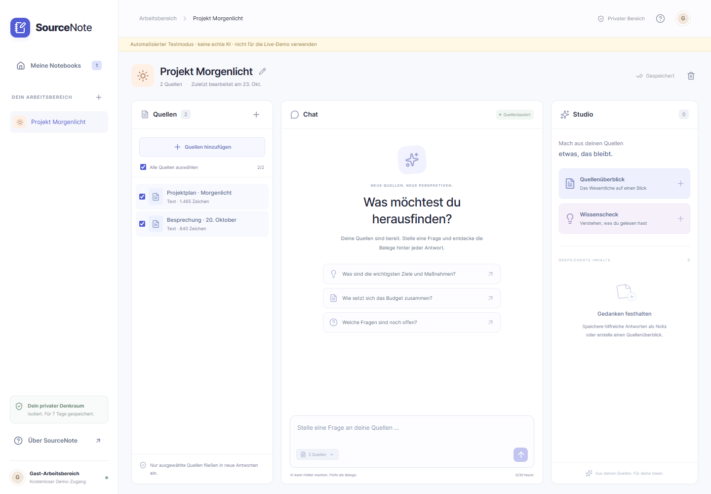

# SourceNote

**Deine Quellen. Klare Antworten.** A German research workspace inspired by NotebookLM, built for Ayham's Everlast Consulting recruitment assignment. Independent project; not affiliated with Google.



Organize documents into notebooks, ask questions about selected sources, inspect supporting excerpts, and turn useful answers into persistent research outputs.

## What works

- Create, search, rename and delete notebooks in an isolated seven-day guest workspace.
- Upload text PDFs, UTF-8 text/Markdown files, or paste text. Preview extracted content, inspect reliable PDF pages, see useful failure states and retry processing.
- Select the sources available for each new question. Full-context evidence is bounded; oversized selections receive an actionable error.
- Generate source-grounded answers and inspect citations resolved from stored source text. Invalid citation IDs are rejected; insufficient evidence has an explicit outcome.
- Generate an overview or three-question knowledge check, save an answer as a note, reopen Studio content and export Markdown with source references.
- Persist across reloads, use desktop panels or narrow-screen tabs, and enforce server-side ownership, request/cost limits, idempotency and deletion rules.

**Status:** implemented and tested locally. Groq Free is configured as the default provider adapter, but a real key has not yet been supplied for live evaluation. GitHub publication, cloud deployment and Loom recording are pending. Browser screenshots use a clearly marked deterministic test provider; they are not evidence of real model quality. [Full delivery audit](docs/delivery-status.md).

## Run locally

Requires **Node.js 24+**. No database installation is necessary: PGlite provides durable local PostgreSQL. With `DATABASE_URL`, the same schema uses a PostgreSQL server through `pg`.

```powershell
npm.cmd ci
Copy-Item .env.example .env.local
# Set GROQ_API_KEY in .env.local; preserve an existing configured file.
npm.cmd run dev
```

Open **http://localhost:3000** and choose **Beispiel erkunden** for a private copy of two synthetic sources. On macOS/Linux use `npm` instead of `npm.cmd`. Local data lives in ignored `.data/`; losing the guest cookie loses access to that workspace.

Use a free Groq key from [Groq Console](https://console.groq.com/keys), with `AI_PROVIDER=groq` and `AI_MODEL=openai/gpt-oss-120b`. No OpenAI key or paid provider is required. The optional Cloudflare/Qwen configuration is in `.env.example`. Without a key the application clearly disables generation while notebook/source functions remain usable. Never enable `AI_TEST_MODE` for the actual demonstration; production rejects it.

## Verify

```powershell
npm.cmd run check
npm.cmd run build
npm.cmd run test:e2e
```

The browser suite uses installed Google Chrome locally; CI installs Chromium. For local Playwright Chromium, install it with `npx playwright install chromium` and set `PLAYWRIGHT_CHROMIUM=true`. Routine tests do not spend model tokens. `npm.cmd run evaluate` runs six bounded cases against a configured real provider and records outputs for semantic review. [Actual results and gaps](docs/testing.md).

## Architecture and delivery

```text
src/app/          Next.js shell, responsive styling and HTTP boundary
src/components/   Interactive workspace and accessible dialogs
src/lib/          Auth, SQL, ingestion, generation, storage and provider adapters
migrations/       PostgreSQL schema, keys, indexes and constraints
fixtures/         CC0 demo sources and adversarial grounding evaluation cases
tests/            Service and provider-boundary integration tests
e2e/              Desktop/mobile browser workflow and isolation checks
scripts/          Migration, real-provider evaluation, PDF parser and diagram tools
docs/             Decisions, diagrams, test evidence and recruitment handoff
```

- [Implemented architecture](docs/architecture.md) · [ADRs](docs/architecture/decisions.md) · [schema/lifecycle](docs/architecture/schema-notes.md) · [HTTP contract](docs/api.md)
- [Native draw.io architecture](docs/architecture/notebooklm-clone.drawio) · [page manifest and imports](docs/architecture/README.md)
- [Zero-spend research](docs/free-tier-research.md) · [deployment/runbook](docs/deployment.md)
- [AI assistance and validation](docs/ai-usage.md) · [8:30 German Loom script](docs/demo-script.md) · [German reply draft](docs/submission-email.de.md)

Free deployment target: **Vercel Hobby + Neon Free + Groq Free**. Original files are bounded private PostgreSQL blobs, so no paid disk or bucket is needed. Required variables and live smoke tests are documented. No hosted URL or recording URL is fabricated; add verified links here after publication.

## Deliberate limits

4 MiB/file, 50 PDF pages, 100k text characters/source, 10 sources/notebook, 3 notebooks/workspace and 4k evidence tokens per generation. Defaults allow 30 attempts/session/day and conservative shared usage/storage budgets. Free-provider limits can require waiting or reducing the selection. These limits serve a focused review demo, not a production-scale claim.

OCR/scanned PDFs, audio overviews, external web/YouTube imports, collaboration, login recovery and payments are deferred. Earlier answers are not used as evidence for follow-up questions; ask standalone questions. Valid citation IDs establish provenance, not semantic correctness. Deleting a source redacts outputs that depended on its selection. The UI explains guest lifetime and third-party AI processing; use the synthetic demo sources for review.

The original supplied architecture prompt remains in `message (2).md`. No employer email has been sent.
